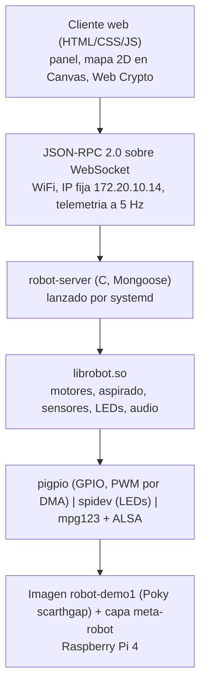
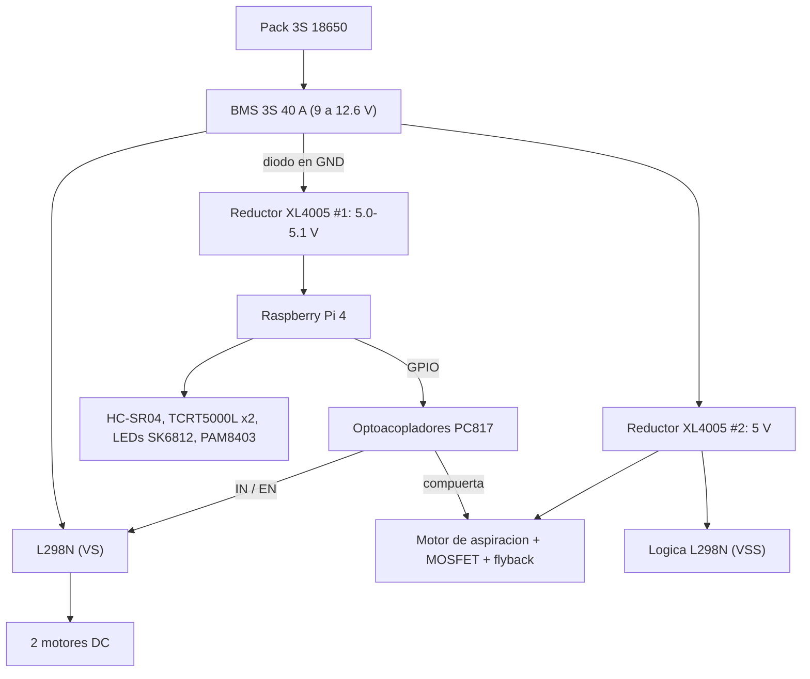
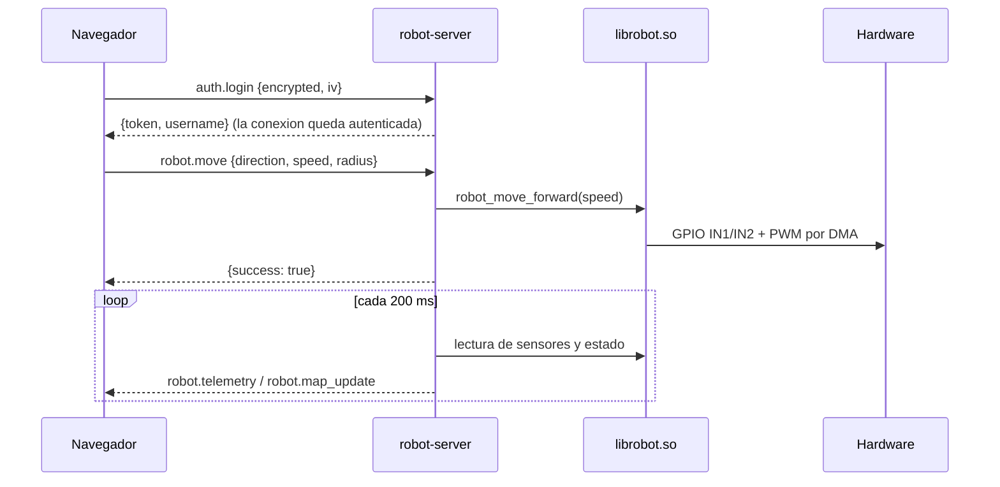
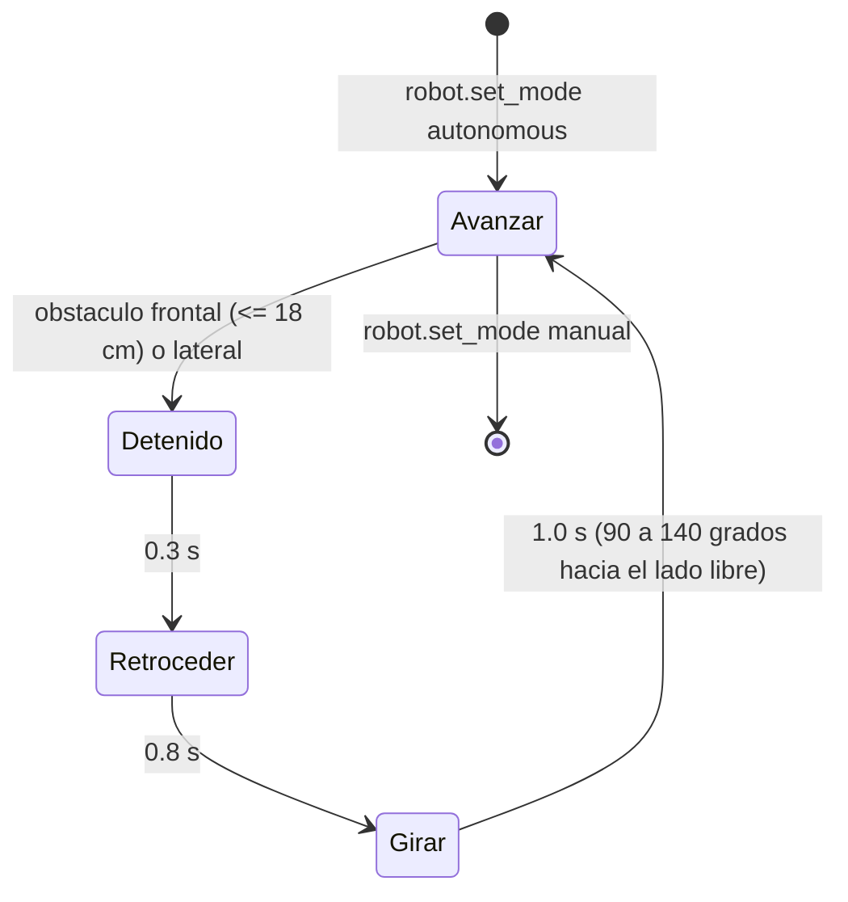
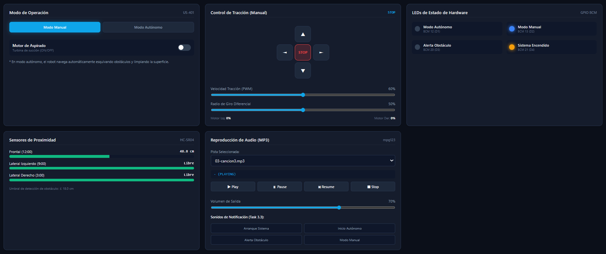
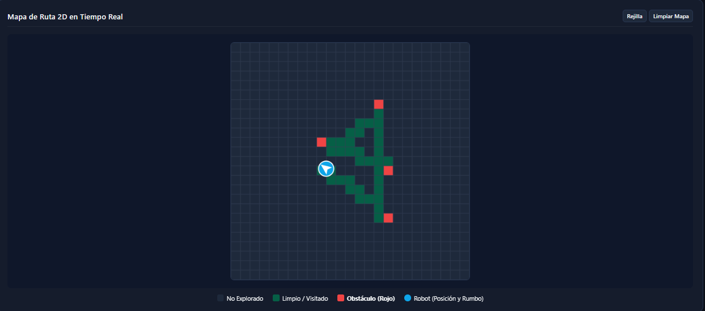
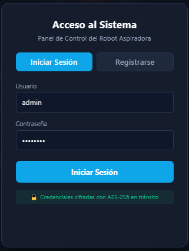
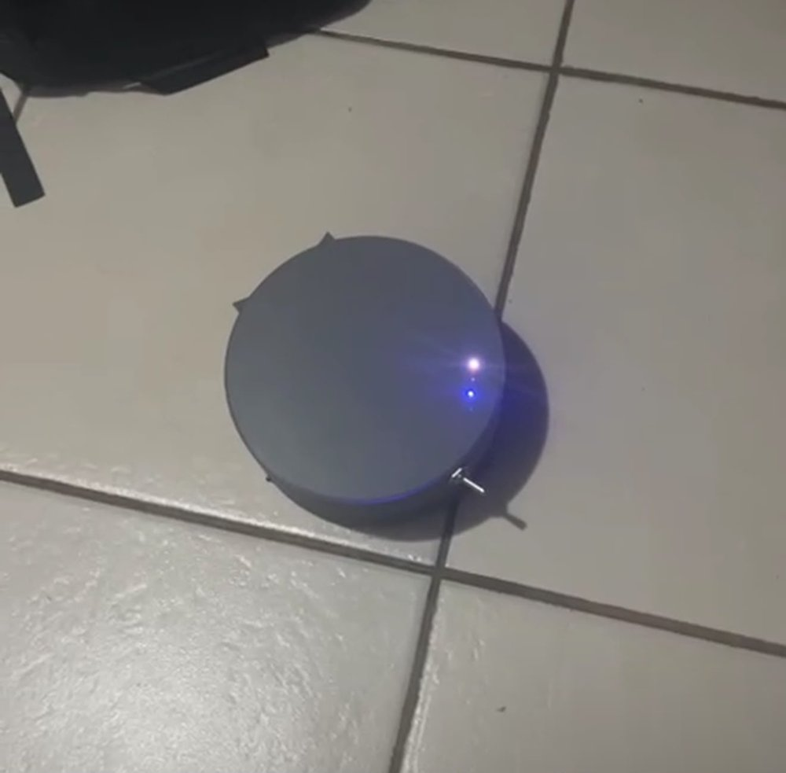
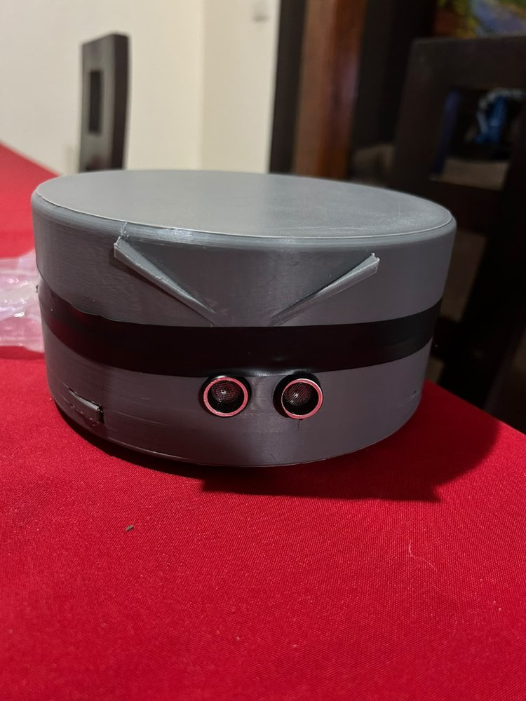

# Robot Aspiradora Autónomo con Yocto (CE-1113)

Sistema embebido a la medida para un robot aspiradora autónomo sobre una Raspberry Pi 4. El robot navega evitando obstáculos, aspira, reproduce MP3, indica su estado con LEDs y se controla por WiFi desde una interfaz web con inicio de sesión. Todo corre sobre una imagen mínima de Linux construida con Yocto (Poky scarthgap 5.0.15) y la capa propia `meta-robot`.

**Versión actual:** Demo 1 v2 (receta de imagen `robot-demo1`).

| Integrante | Carné |
|---|---|
| Gabriel Bolaños Barboza | 2022327511 |
| Yerik Chaves Serrano | 2022437493 |
| Emmanuel Esquivel Chavarría | 2022312336 |
| Sergio Marín Zuñiga | 2018171984 |

Curso: CE-1113 Sistemas Empotrados, Instituto Tecnológico de Costa Rica. Profesor: Dr.-Ing. Jeferson González Gómez.

---

## Contenido

1. [Propósito y funcionalidades](#propósito-y-funcionalidades)
2. [Arquitectura](#arquitectura)
3. [Módulos del sistema](#módulos-del-sistema)
4. [Estructura del repositorio](#estructura-del-repositorio)
5. [Hardware y asignación de pines](#hardware-y-asignación-de-pines)
6. [Dependencias](#dependencias)
7. [Instalación y compilación](#instalación-y-compilación)
8. [Grabación y ejecución](#grabación-y-ejecución)
9. [API de la biblioteca librobot](#api-de-la-biblioteca-librobot)
10. [API del servidor (JSON-RPC 2.0)](#api-del-servidor-json-rpc-20)
11. [Resultados y evidencias](#resultados-y-evidencias)
12. [Limitaciones conocidas](#limitaciones-conocidas)
13. [Documentación y decisiones de diseño](#documentación-y-decisiones-de-diseño)
14. [Flujo de trabajo en Git](#flujo-de-trabajo-en-git)

---

## Propósito y funcionalidades

El proyecto integra hardware, una biblioteca de control propia, un servidor web embebido y una imagen Linux mínima para que el robot opere sin interfaz gráfica local: al encender la Raspberry Pi, `systemd` levanta el servidor y el robot queda listo para controlarse desde un navegador.

| Requerimiento | Implementación |
|---|---|
| Navegación autónoma | Cobertura aleatoria con rebote: ante un obstáculo el robot se detiene, retrocede 0.8 s y gira hacia el lado libre. |
| Detección de obstáculos | HC-SR04 frontal (umbral de 18 cm) y dos TCRT5000L laterales, leídos en un hilo propio. |
| Tracción diferencial | Dos motores DC con L298N detrás de optoacopladores PC817; PWM por software a 1 kHz; avance, retroceso, giros con radio variable y detención. |
| Motor de aspiración | Encendido desde el panel en modo manual y automáticamente en modo autónomo (GPIO26, MOSFET de lado bajo). |
| LEDs de estado | Tira de 4 SK6812MINI-E por SPI: blanco (sistema), verde (autónomo), azul (manual), rojo (obstáculo). |
| Audio MP3 | `mpg123` concurrente con la navegación: lista de canciones, reproducir, pausar, reanudar, detener y volumen. |
| Notificaciones sonoras | Inicio del sistema, inicio del modo autónomo, obstáculo detectado y cambio a modo manual. |
| Control remoto | Servidor en C (Mongoose 7.23) con JSON-RPC 2.0 sobre WebSocket y cliente web con modos, control direccional, sensores, audio, LEDs y mapa 2D en tiempo real. |
| Autenticación | Inicio de sesión y registro con credenciales cifradas AES-256-CBC (Web Crypto en el cliente, OpenSSL en el servidor). |
| Ejecución automática | Unidad `systemd` propia (`robot-server.service`) con `Restart=on-failure`. |
| Biblioteca propia | `librobot.so`, compilada de forma cruzada con CMake; es el único acceso al hardware. |
| Métricas | Script `robot-metricas` incluido en la imagen (rootfs, arranque, RAM, CPU y temperatura). |

---

## Arquitectura

### Capas de software



El servidor no accede a GPIO, PWM ni audio directamente: toda interacción con el hardware pasa por `librobot.so`.

### Hardware



Las señales hacia la etapa de potencia pasan por optoacopladores, y un diodo en la tierra del reductor de la Raspberry Pi bloquea las corrientes de retorno (solución aprobada por el profesor). El esquemático completo está en [`docs/img/esquematico.png`](docs/img/esquematico.png).

### Flujo de un comando desde el navegador



### Navegación autónoma



Al detectar el obstáculo el robot también enciende el LED rojo, reproduce la notificación de obstáculo y marca la celda en el mapa.

---

## Módulos del sistema

| Módulo | Archivo | Responsabilidad |
|---|---|---|
| librobot | `librobot/src/librobot.c` | `robot_init()` / `robot_cleanup()`: inicializa pigpio y cada módulo en orden. |
| | `librobot/src/motor.c` | Tracción diferencial con rampa de velocidad y PWM por software. |
| | `librobot/src/sensors.c` | HC-SR04 (medición de pulso con pigpio) y TCRT5000L. |
| | `librobot/src/leds.c` | Tira SK6812 por SPI, parpadeo no bloqueante. |
| | `librobot/src/audio.c` | Proceso `mpg123 -R` persistente controlado por pipe. |
| | `librobot/src/robot_pins.h` | Asignación de pines y niveles de activación. |
| | `librobot/tests/robot_selftest.c` | Programa `robot-selftest` para probar el hardware en la Pi. |
| Servidor | `server/src/main.c` | Bucle de Mongoose, HTTP, WebSocket, telemetría a 5 Hz y señales. |
| | `server/src/rpc_handlers.c` | Métodos JSON-RPC y control de sesión por conexión. |
| | `server/src/hw_robot.c` | Puente con librobot: hilo de sensores, navegación autónoma, mapa y odometría. |
| | `server/src/auth.c`, `crypto_util.c` | Usuarios en `users.db` y descifrado AES-256-CBC con OpenSSL EVP. |
| Cliente | `client/js/app.js` | Panel, controles, telemetría y mapa 2D en Canvas. |
| | `client/js/rpc.js`, `crypto.js` | Cliente JSON-RPC sobre WebSocket y cifrado con Web Crypto. |
| Yocto | `Yocto_files/meta-robot/` | Recetas de la imagen, la biblioteca, el servidor, el audio, el WiFi y las métricas. |

---

## Estructura del repositorio

```text
Yocto_files/
  Local_config/                 local.conf y bblayers.conf usados para la imagen
  meta-robot/                   Capa Yocto propia
    recipes-image/robot-demo1/    Receta de la imagen final (bitbake robot-demo1)
    recipes-robot/librobot/       Biblioteca de control (CMake)
    recipes-robot/robot-server/   Servidor web + unidad systemd
    recipes-robot/robot-metricas/ Script de métricas y medición de arranque
    recipes-audio/robot-media/    Canciones y efectos de sonido
    recipes-audio/robot-startup-sound/
    recipes-connectivity/robot-wifi/  wpa_supplicant + systemd-networkd + aviso de IP
    recipes-support/pigpio/
    recipes-multimedia/mpg123/, recipes-bsp/rpi-cmdline/  (bbappend)
librobot/                       Fuentes de librobot.so y robot-selftest
server/                         Servidor C (Mongoose, CMake y Makefile)
client/                         Cliente web
tests/                          Pruebas end-to-end del servidor (Python)
docs/
  ADR/                          Registros de decisiones de arquitectura
  metrics/                      Verificación del host y arranque inicial (US-201, US-202)
  evidencias/                   Logs de compilación cruzada y manifiesto de la imagen
  img/                          Esquemático y capturas del sistema
  documento_diseño.pdf          Documento de Diseño
  documento_aprendizaje.pdf     Documento de Aprendizaje Continuo
  CONTRIBUTING.md               Guía de contribución
```

---

## Hardware y asignación de pines

Numeración BCM, según `librobot/src/robot_pins.h`.

| Función | GPIO | Observación |
|---|---|---|
| Motor izquierdo IN1 / IN2 / EN | 22 / 23 / 19 | Canal B del L298N, PWM por software a 1 kHz |
| Motor derecho IN1 / IN2 / EN | 17 / 27 / 18 | Canal A del L298N, PWM por software a 1 kHz |
| Motor de aspirado | 26 | Optoacoplador + MOSFET canal N; encendido con nivel alto |
| HC-SR04 frontal TRIG / ECHO | 16 / 4 | ECHO con divisor 1 kΩ / 2 kΩ (5 V a 3.3 V) |
| TCRT5000L izquierdo / derecho | 5 / 25 | Salida digital, activa en bajo |
| LEDs SK6812 ×4 | 10 (SPI0 MOSI) | 330 Ω en serie, alimentados a 3.3 V |
| Audio | Jack 3.5 mm | Amplificador PAM8403 |

Notas de diseño:

- **PWM por software:** el audio analógico de la Raspberry Pi usa el mismo periférico que el PWM por hardware de los GPIO 18 y 19. Con PWM por hardware el jack queda mudo en cuanto se mueven los motores, por eso se usa el PWM por DMA de `pigpio`.
- **Polaridad invertida:** los PC817 invierten la señal hacia el L298N. La biblioteca escribe el ciclo de trabajo como `100 - velocidad`, así que un PWM de 0 en el GPIO equivale a velocidad máxima.

---

## Dependencias

### Equipo de construcción (host)

Ubuntu 22.04 o 24.04 (distribuciones soportadas por scarthgap), más de 100 GB libres de disco y los paquetes que pide Yocto scarthgap:

```bash
sudo apt install gawk wget git diffstat unzip texinfo gcc g++ build-essential chrpath socat \
  cpio python3 python3-pip python3-pexpect xz-utils debianutils iputils-ping python3-git \
  python3-jinja2 python3-subunit zstd lz4 file locales libacl1 libegl1 libsdl1.2-dev mesa-common-dev
```

La verificación de estos paquetes en dos equipos del equipo está en [`docs/metrics/host-check1.md`](docs/metrics/host-check1.md) y [`docs/metrics/host-check2.md`](docs/metrics/host-check2.md).

### Capas de Yocto

| Capa | Rama | Uso |
|---|---|---|
| `poky` (`meta`, `meta-poky`, `meta-yocto-bsp`) | `scarthgap-5.0.15` | Distribución base |
| `meta-raspberrypi` | `scarthgap` | BSP de la Raspberry Pi 4 |
| `meta-robot` | este repositorio | Recetas propias del proyecto |

### Compilación local (opcional, fuera de Yocto)

`cmake`, `gcc`, `libpigpio-dev` (librobot) y `libssl-dev` (servidor). Las pruebas de `tests/` requieren `python3` y el paquete `cryptography`.

### En la imagen (target)

Los paquetes que la receta `robot-demo1.bb` agrega a `core-image-minimal` se justifican en [Paquetes agregados a la imagen mínima](#paquetes-agregados-a-la-imagen-mínima).

---

## Instalación y compilación

### 1. Descargar Poky y la capa de la Raspberry Pi

```bash
git clone -b scarthgap-5.0.15 git://git.yoctoproject.org/poky ~/poky-scarthgap-5.0.15
cd ~/poky-scarthgap-5.0.15
git clone -b scarthgap https://github.com/agherzan/meta-raspberrypi.git
git clone https://github.com/Yerik1/Robot-Aspiradora-Yocto.git
cp -r Robot-Aspiradora-Yocto/Yocto_files/meta-robot .
```

### 2. Fuentes del proyecto

Las recetas `librobot`, `robot-server` y `robot-media` toman las fuentes de `/home/lelito/robot-files` (`FILESEXTRAPATHS`). En otra máquina, copiar las carpetas ahí o cambiar esa ruta en las tres recetas.

```bash
R=~/poky-scarthgap-5.0.15/Robot-Aspiradora-Yocto
mkdir -p ~/robot-files/media/musica ~/robot-files/media/efectos
cp -r $R/librobot $R/server $R/client ~/robot-files/
cp $R/server/SoundEffects/*.mp3 ~/robot-files/media/efectos/
cp $R/server/music/*.mp3 ~/robot-files/media/musica/
```

### 3. Configurar el entorno de construcción

```bash
cd ~/poky-scarthgap-5.0.15
source oe-init-build-env rpi4
cp ../Robot-Aspiradora-Yocto/Yocto_files/Local_config/local.conf conf/local.conf
cp ../Robot-Aspiradora-Yocto/Yocto_files/Local_config/bblayers.conf conf/bblayers.conf
```

`oe-init-build-env` se ejecuta en cada terminal nueva. Configuración relevante de `local.conf`:

| Variable | Valor | Motivo |
|---|---|---|
| `MACHINE` | `raspberrypi4` | Imagen ARM de 32 bits (`armv7l`) para la Raspberry Pi 4 |
| `INIT_MANAGER` | `systemd` | Arranque de los servicios propios |
| `ENABLE_SPI_BUS` | `1` | Bus SPI para la tira de LEDs |
| `RPI_EXTRA_CONFIG` | `dtparam=audio=on`, `core_freq=500`, `core_freq_min=500` | Audio del jack y reloj fijo del núcleo para que el SPI sea estable |
| `LICENSE_FLAGS_ACCEPTED` | `synaptics-killswitch` | Licencia del firmware WiFi de la Raspberry Pi 4 |
| `IMAGE_FEATURES` | `ssh-server-dropbear` | Acceso SSH durante el desarrollo |
| `INHERIT` | `rm_work` | Borra los directorios de trabajo para ahorrar disco |

### 4. Credenciales WiFi

Editar `meta-robot/recipes-connectivity/robot-wifi/files/wpa_supplicant-wlan0.conf` y reemplazar `NOMBRE_DE_LA_RED` y `CLAVE_DE_LA_RED`. La IP fija (`172.20.10.14/28`) corresponde a la red del hotspot de un iPhone y se cambia en `25-wlan.network`.

### 5. Construir la imagen

```bash
bitbake robot-demo1
```

La imagen queda en `tmp/deploy/images/raspberrypi4/robot-demo1-raspberrypi4.rootfs.wic.bz2`, junto con su `.wic.bmap`.

### 6. Compilación cruzada con la toolchain

La compilación cruzada ocurre dentro de Yocto: las recetas de `librobot` y `robot-server` heredan `cmake` y usan la toolchain `arm-poky-linux-gnueabi`. Los logs están en [`docs/evidencias/`](docs/evidencias/).

Para compilar fuera de BitBake con el SDK de la imagen:

```bash
bitbake robot-demo1 -c populate_sdk
sh tmp/deploy/sdk/poky-glibc-x86_64-robot-demo1-*-raspberrypi4-toolchain-5.0.15.sh
source /opt/poky/5.0.15/environment-setup-*

cd librobot && mkdir -p build && cd build && cmake .. && make
cd ../../server && mkdir -p build && cd build && cmake .. && make
```

---

## Grabación y ejecución

### Grabar la tarjeta SD

```bash
lsblk                                   # identificar la SD, p. ej. /dev/sdc
sudo umount /dev/sdX1 /dev/sdX2
sudo bmaptool copy robot-demo1-raspberrypi4.rootfs.wic.bz2 /dev/sdX
```

**Advertencia:** todo el contenido de `/dev/sdX` se borra. En Windows se puede usar balenaEtcher con el archivo `.wic.bz2`.

### Uso

1. Activar el hotspot (en iPhone, con "Maximizar compatibilidad") **antes** de encender el robot.
2. Encender el robot. Suena el sonido de inicio y, si hay un monitor conectado, aparece la IP del WiFi en la consola.
3. Desde un equipo conectado al mismo hotspot, abrir `http://172.20.10.14:8080`.
4. Iniciar sesión con `admin` / `admin123` o registrar una cuenta nueva. La contraseña por defecto debe cambiarse antes de una demostración pública.

### Servicios systemd

| Servicio | Función |
|---|---|
| `robot-startup-sound.service` | Sonido de inicio del sistema |
| `wpa_supplicant@wlan0.service` | Conexión al WiFi |
| `robot-server.service` | Servidor web y control del robot (`Restart=on-failure`) |
| `robot-ip.service` | Muestra la IP en la consola al conectarse |
| `robot-metricas-arranque.service` | Registra el tamaño del rootfs y el tiempo de arranque |

### Diagnóstico en el target

```bash
systemctl status robot-server
journalctl -u robot-server -f
robot-selftest sensores      # con robot-server detenido
robot-selftest motores
robot-metricas 30
```

---

## API de la biblioteca librobot

Encabezado: `librobot/include/librobot.h`. Todas las funciones retornan `robot_status_t`, salvo `sensor_obstacle_detected()`.

### Códigos de estado

| Código | Valor | Significado |
|---|---|---|
| `ROBOT_OK` | 0 | Éxito |
| `ROBOT_ERR_NOT_INITIALIZED` | -1 | Falta llamar a `robot_init()` |
| `ROBOT_ERR_INVALID_PARAM` | -2 | Parámetro fuera de rango |
| `ROBOT_ERR_GPIO` | -3 | Error de GPIO |
| `ROBOT_ERR_PWM` | -4 | Error de PWM |
| `ROBOT_ERR_SENSOR_TIMEOUT` | -5 | Sin eco del HC-SR04 (nada al alcance) |
| `ROBOT_ERR_AUDIO` | -6 | Error del módulo de audio |
| `ROBOT_ERR_AUDIO_FILE_NOT_FOUND` | -7 | Archivo de audio inexistente |

### Funciones

| Módulo | Función | Descripción |
|---|---|---|
| Sistema | `robot_init()` | Inicializa GPIO, PWM, sensores, LEDs y audio. Se llama una vez. |
| | `robot_cleanup()` | Detiene motores y audio y libera el hardware. |
| Tracción | `motor_set_speed(motor, duty_percent, direction)` | Controla un motor (0 a 100 %, adelante o atrás). |
| | `motor_stop(motor)` / `motor_stop_all()` | Detiene un motor o ambos. |
| | `robot_move_forward(speed)` / `robot_move_backward(speed)` | Movimiento recto. |
| | `robot_turn_left(speed, radius)` / `robot_turn_right(speed, radius)` | Giro; `radius` 0 = sobre su eje, 100 = giro amplio. |
| Aspirado | `vacuum_on()` / `vacuum_off()` / `vacuum_is_on(&on)` | Control del motor de succión. |
| Sensores | `sensor_read_distance_cm(SENSOR_FRONT, &cm)` | Distancia del HC-SR04 frontal. |
| | `sensor_read_obstacle(sensor, threshold_cm, &detected)` | Obstáculo en el sensor dado (frontal por umbral, laterales digitales). |
| | `sensor_obstacle_detected(sensor, threshold_cm)` | Versión simplificada; retorna `bool`. |
| LEDs | `led_set(led, on)` / `led_toggle(led)` | Enciende, apaga o alterna un LED. |
| | `led_blink(led, freq_hz, duration_ms)` / `led_stop_blink(led)` | Parpadeo no bloqueante. |
| Audio | `audio_play_file(path)` | Reproduce un MP3. |
| | `audio_play_notification(event)` | Notificación: inicio, autónomo, obstáculo, manual. |
| | `audio_pause()` / `audio_resume()` / `audio_stop()` | Control de reproducción. |
| | `audio_set_volume(percent)` / `audio_get_volume(&percent)` | Volumen (0 a 100). |
| | `audio_get_state(&state)` | `AUDIO_STOPPED`, `AUDIO_PLAYING` o `AUDIO_PAUSED`. |
| | `audio_list_files(paths, max, &found)` | Lista los MP3 de `/usr/share/robot-aspirador/music`. |

Ejemplo mínimo:

```c
#include <librobot.h>

int main(void) {
    if (robot_init() != ROBOT_OK) return 1;
    led_set(LED_SYSTEM_ON, true);
    robot_move_forward(60);
    if (sensor_obstacle_detected(SENSOR_FRONT, 18.0f)) {
        motor_stop_all();
        audio_play_notification(AUDIO_EVENT_OBSTACLE);
    }
    robot_cleanup();
    return 0;
}
```

---

## API del servidor (JSON-RPC 2.0)

El servidor escucha en el puerto 8080 (`robot-server -p 8080 -r <cliente> -d <users.db>`) y atiende JSON-RPC en `ws://<ip>:8080/websocket`. Todos los métodos, excepto los de autenticación, requieren haber hecho `auth.login` en la misma conexión; si no, responden con el error 401.

| Grupo | Métodos |
|---|---|
| Autenticación | `auth.login`, `auth.register`, `auth.logout` |
| Robot | `robot.set_mode`, `robot.move`, `robot.stop`, `robot.vacuum` |
| Audio | `audio.play`, `audio.pause`, `audio.resume`, `audio.stop`, `audio.volume`, `audio.notification`, `audio.list_files` |
| Mapa | `map.get`, `map.reset` |
| Sistema | `system.status`, `rpc.list` |

Ejemplo de comando y respuesta:

```json
{"jsonrpc":"2.0","id":7,"method":"robot.move","params":{"direction":"forward","speed":60,"radius":50}}
{"id":7,"result":{"success":true}}
```

Notificaciones del servidor hacia el cliente (5 Hz): `robot.telemetry` (modo, sensores, motores, LEDs, audio y posición) y `robot.map_update` (solo las celdas del mapa que cambiaron). La descripción completa de cada método y sus parámetros está en [`docs/ADR/ADR-004.md`](docs/ADR/ADR-004.md).

---

## Resultados y evidencias

### Pruebas funcionales en el robot

Realizadas con la imagen `robot-demo1` en la Raspberry Pi 4, controlando el robot desde el navegador.

| Prueba | Criterio | Resultado |
|---|---|---|
| Navegación autónoma | Ante un obstáculo se detiene, retrocede y gira | Cumple |
| Mapa 2D | Marca lo recorrido (verde) y los obstáculos (rojo) en tiempo real | Cumple |
| Notificaciones | Suenan los cuatro eventos | Cumple; la de inicio se escucha más baja por el ruido del motor de aspiración |
| LEDs | Blanco (sistema), verde (autónomo), azul (manual), rojo (obstáculo) | Cumple |
| Autenticación | Inicio de sesión, registro y acceso con la cuenta nueva | Cumple |
| Reproductor | Selección, reproducir, pausar, reanudar, detener y volumen | Cumple |
| Control manual | Cuatro direcciones, detención, velocidad y radio de giro | Cumple, con un leve desvío al cambiar de dirección (ver limitaciones) |
| Aspiradora | Botón manual y encendido automático en modo autónomo | Cumple |

### Capturas

| Panel de control | Mapa 2D |
|---|---|
|  |  |

| Inicio de sesión | Robot en operación | Modelo físico |
|---|---|---|
|  |  |  |

### Métricas de eficiencia de recursos

Medidas en la Raspberry Pi 4 con `robot-metricas 30`, en operación normal: modo autónomo, música reproduciéndose y servidor web en uso. La CPU se promedió durante 30 s.

| Métrica | Resultado | Referencia | Herramienta |
|---|---|---|---|
| Tamaño del rootfs | 68 MB (partición: 76 de 141 MB) | ≤ 200 MB | `du -sxm /`, `df -m /` |
| Arranque hasta `robot-server` operativo | 5.37 s desde el inicio del kernel | ≤ 15 s | `systemctl show -p ActiveEnterTimestampMonotonic robot-server` |
| RAM en uso | 100 MB de 1868 MB (5.3 %) | - | `/proc/meminfo` |
| RAM por proceso | `robot-server` 3.8 MB, `mpg123` 2.4 MB | - | `VmRSS` en `/proc/<pid>/status` |
| CPU total (4 núcleos) | 2.4 % | - | `/proc/stat` |
| CPU por proceso | `robot-server` 9.6 %, `mpg123` 0.9 % (de un núcleo) | - | `/proc/<pid>/stat` |
| Temperatura del SoC | 45.8 °C | - | `/sys/class/thermal/thermal_zone0/temp` |

**Interpretación:**

- **Rootfs y arranque:** el rootfs ocupa un tercio del máximo y el servidor queda operativo en un tercio del tiempo de referencia. Partir de `core-image-minimal` y agregar solo los paquetes justificados mantiene la imagen pequeña. La medición de arranque no incluye la etapa de firmware de la Raspberry Pi, anterior al kernel; el margen de 9.6 s permite absorberla.
- **RAM y CPU:** el consumo deja casi toda la memoria y la CPU libres. El proceso que más CPU usa es `robot-server`, por el ciclo de control y telemetría de 200 ms y el hilo de sensores.

### Paquetes agregados a la imagen mínima

Base: `core-image-minimal`. Paquetes agregados, según el manifiesto de la imagen ([`docs/evidencias/robot-demo1.manifest`](docs/evidencias/robot-demo1.manifest)):

| Paquete | Justificación |
|---|---|
| `librobot0`, `librobot-selftest` | Biblioteca de control y programa de prueba del hardware |
| `pigpio` | GPIO, PWM por DMA y medición de pulsos del HC-SR04 |
| `kernel-module-spi-bcm2835`, `kernel-module-spidev` | Bus SPI para la tira de LEDs |
| `mpg123`, `alsa-utils` | Decodificador MP3 y mezclador del jack |
| `robot-startup-sound`, `robot-media` | Sonido de inicio, canciones y notificaciones |
| `robot-server`, `libssl3` | Servidor web y cifrado de credenciales |
| `robot-wifi`, `wpa-supplicant`, `iw` | Conexión WiFi con IP fija |
| `kernel-module-brcmfmac`, `kernel-module-brcmfmac-wcc`, `linux-firmware-rpidistro-bcm43455`, `wireless-regdb-static` | Driver, módulo de proveedor (kernel 6.6) y firmware del WiFi |
| `robot-metricas`, `systemd-analyze` | Medición de las métricas |
| `dropbear` | Acceso SSH durante el desarrollo |

### Evidencias de construcción

| Evidencia | Archivo |
|---|---|
| Verificación de dependencias del host (US-201) | [`docs/metrics/host-check1.md`](docs/metrics/host-check1.md), [`docs/metrics/host-check2.md`](docs/metrics/host-check2.md) |
| Primer arranque de la imagen en la Raspberry Pi 4 (US-202) | [`docs/metrics/us202_evidence.md`](docs/metrics/us202_evidence.md) |
| Compilación cruzada de librobot con `arm-poky-linux-gnueabi-gcc` | [`docs/evidencias/librobot-log.do_compile.txt`](docs/evidencias/librobot-log.do_compile.txt) |
| Compilación cruzada del servidor | [`docs/evidencias/robot-server-log.do_compile.txt`](docs/evidencias/robot-server-log.do_compile.txt) |
| Paquetes de la imagen final | [`docs/evidencias/robot-demo1.manifest`](docs/evidencias/robot-demo1.manifest) |

### Pruebas automatizadas del servidor

`tests/test_client.py` prueba de punta a punta el servidor web: archivos estáticos, handshake WebSocket, inicio de sesión y registro cifrados, comandos del robot y del audio, mapa y recepción de telemetría. Se escribió en la etapa de desarrollo del servidor y se conecta a `127.0.0.1:8080`, así que se ejecuta en el mismo equipo donde corre el servidor:

```bash
pip install cryptography
python3 tests/test_client.py
```

---

## Limitaciones conocidas

- **Cambio de dirección:** la biblioteca aplica la rampa de velocidad (5 % cada 15 ms) primero a un motor y luego al otro. Al arrancar o invertir el sentido, un motor empieza hasta unos 180 ms antes, lo que produce un pequeño desvío.
- **Lógica de la aspiradora:** el encendido con GPIO26 en alto se resolvió en el servidor (`hw_robot_set_vacuum_manual`); falta unificarlo en `librobot` para que `vacuum_on()` corresponda directamente al nivel alto.
- **Odometría:** sin encoders, el mapa se estima por tiempo y acumula error con la distancia.
- **Sensores laterales:** el TCRT5000L detecta solo a pocos milímetros, y su umbral depende del potenciómetro del módulo y de la superficie.
- **Seguridad:** no se usa TLS; el cifrado de credenciales es el protocolo mínimo que pide la especificación.
- **Rutas locales:** algunas recetas apuntan a `/home/lelito/robot-files`; en otra máquina hay que ajustar `FILESEXTRAPATHS`.

---

## Documentación y decisiones de diseño

| Documento | Contenido |
|---|---|
| [`docs/documento_diseño.pdf`](docs/documento_diseño.pdf) | Documento de Diseño (DI1 a DI4): requerimientos, alternativas, diseño y validación |
| [`docs/documento_aprendizaje.pdf`](docs/documento_aprendizaje.pdf) | Documento de Aprendizaje Continuo (AC1 a AC4) |
| [`docs/ADR/ADR-001.md`](docs/ADR/ADR-001.md) | Separación de dominios eléctricos y aislamiento de la etapa de potencia |
| [`docs/ADR/ADR-002.md`](docs/ADR/ADR-002.md) | Alimentación con batería 3S y reductores XL4005 |
| [`docs/ADR/ADR-003.md`](docs/ADR/ADR-003.md) | Chasis (la reutilización del chasis tipo Roomba se reemplazó por un chasis impreso en 3D de dos pisos por falta de espacio) |
| [`docs/ADR/ADR-004.md`](docs/ADR/ADR-004.md) | Servidor web embebido con Mongoose y protocolo JSON-RPC |
| [`server/README.md`](server/README.md) | Detalle del servidor y del cliente web |

---

## Flujo de trabajo en Git

El detalle está en [`docs/CONTRIBUTING.md`](docs/CONTRIBUTING.md). En resumen:

- **Ramas:** `main` recibe solo merges desde `dev` (rama de integración); cada cambio se hace en una rama `feature/`, `fix/`, `docs/` o `chore/` creada desde `dev`.
- **Commits:** Conventional Commits, `<tipo>(<ámbito>): <descripción en imperativo>`, un commit por cambio lógico.
- **Integración:** pull request hacia `dev` con `Closes #N`, revisado por otro integrante. No se usa `push --force`.
- **Seguimiento:** cada historia de usuario es un issue del proyecto "Backlog Aspiradora-Yocto".
